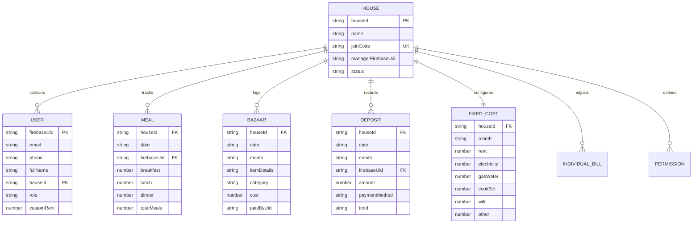
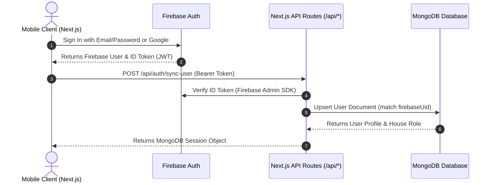
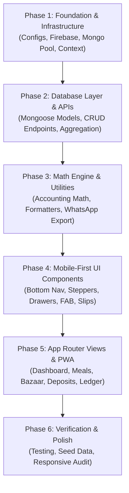

# 📋 Master Execution Plan: Smart MMS (মেস ম্যানেজার)
### Next.js (App Router) + MongoDB + Firebase Auth + Mobile-First Architecture

---

## 🎯 1. Project Overview & Architectural Vision

**Smart MMS (মেস ম্যানেজার)** is a specialized financial tracking and bachelor mess management application built specifically for the Bangladeshi bachelor mess ecosystem. It eliminates dispute-prone paper meal sheets, calculates real-time live meal rates, automates shared utility bill distribution, provides 1-click WhatsApp billing summaries, and delivers a mobile-first native app feel.

### Core Architectural Pillars
- **Framework**: Next.js 14+ (App Router) with React 18/19 & TypeScript.
- **Database**: MongoDB (Atlas or local) with Mongoose schemas and cached singleton connection pooling.
- **Authentication**: Firebase Authentication (Client SDK for Email/Password, Phone OTP, Google Sign-in; Firebase Admin SDK for server-side token verification and RBAC).
- **Design System**: Mobile-First, dark glassmorphic UI (`#0f172a` slate background, backdrop-blur cards, amber/emerald accents, `Hind Siliguri` + `Inter` typography).
- **PWA Capabilities**: Installable standalone mobile web app with safe-area padding and thumb-friendly navigation.

---

## 📱 2. Mobile-First UX & Design System Specification

The primary target viewport is **360px – 430px** (iPhone 14/15/16, Samsung Galaxy S-series), expanding gracefully to tablet (`md:`) and desktop (`lg:`).

```
+------------------------------------------+
| 🏠 ধানমন্ডি পয়েন্ট | 📅 ২০২৬-১১ | 👤 (User) | <- Top Mobile App Bar (Fixed)
+------------------------------------------+
|  [ ⚠️ আপনার বকেয়া: ৳ ১,২৫০ / পাবে: ৳ ৭৫০ ]  | <- Net Financial Alert Banner
+------------------------------------------+
|  [ 📊 মিল রেট: ৳৪৫ ] [ 🍽️ মোট মিল: ২৬৫ ]   | <- Compact Mobile KPI Cards
|  [ 🛒 মোট বাজার: ৳১২,০০০ ] [ 💰 জমা: ৳১৫,০০০] |
+------------------------------------------+
|  📅 আজকের দ্রুত মিল এন্ট্রি (১-ক্লিক কাউন্টার)    |
|  সকাল: [-] 1 [+] | দুপুর: [-] 2 [+] | রাত:.. | <- Stepper Controls (Min 48px)
+------------------------------------------+
|  🛒 সাম্প্রতিক বাজার খরচ তালিকা                  |
|  - মুরগি ও ডিম (শাকিল) ........ ৳ ১,২০০     |
|  - তেল, মসলা ও ডাল (রাকিব) .... ৳ ৮৫০      |
+------------------------------------------+
|  [ ➕ দ্রুত এন্ট্রি Floating Action Button ]  | <- Thumb-Zone FAB (Bottom Right)
+------------------------------------------+
| [📊 ড্যাশবোর্ড] [🍽️ মিল] [🛒 বাজার] [💰 জমা] [📑 লেজার] | <- Sticky Bottom Nav
+------------------------------------------+
```

### Mobile Interaction Rules
1. **Thumb-Zone Navigation**: The sticky bottom navigation bar hosts the 5 core views (`Dashboard`, `Meals`, `Bazaar`, `Deposits`, `Ledger`).
2. **Bottom Sheet Drawers (`BottomDrawer.tsx`)**: Replaces modal popups with slide-up drawers from the screen bottom for one-handed thumb interaction.
3. **Minimum 48px Touch Targets**: All interactive elements (stepper buttons `+`/`-`, navigation tabs, submit actions) adhere to WCAG accessibility touch size guidelines.
4. **Optimistic UI Feedback**: Instant visual increment/decrement on meal counts before server round-trips.

---

## 🗄️ 3. Database Modeling & Indexes (MongoDB Mongoose)



### Critical Database Indexes
- `meals`: `{ houseId: 1, date: 1, firebaseUid: 1 }` (Unique compound index)
- `fixed_costs`: `{ houseId: 1, month: 1 }` (Unique compound index)
- `bazaars`: `{ houseId: 1, month: 1, date: 1 }`
- `deposits`: `{ houseId: 1, month: 1, firebaseUid: 1 }`
- `users`: `{ firebaseUid: 1 }` (Unique index) and `{ houseId: 1 }`

---

## 🔐 4. Authentication & Security Flow



### Security & RBAC Policies
- **Super Admin**: Cross-house oversight, create houses, assign house managers.
- **House Manager**: Add/edit house members, enter bulk meals, record house deposits, enter utility bills.
- **Regular Member**: Scoped to personal dashboard, enter own meals (if allowed by permissions), view personal balance, download receipts.

---

## 🧮 5. Core Accounting Engine & Math Formulas

All calculations run in pure TypeScript (`src/lib/calculations.ts`) with zero floating-point drift:

$$\text{Total House Meals} = \sum (\text{Breakfast} + \text{Lunch} + \text{Dinner})$$

$$\text{Live Meal Rate} = \frac{\text{Total House Bazaar Expenses (চলতি বাজার খরচ)}}{\text{Total House Meals (মোট মিল সংখ্যা)}}$$

$$\text{Member Meal Expense} = \text{Individual Total Meals} \times \text{Live Meal Rate}$$

$$\text{Shared Utility Per Head} = \frac{\text{Rent} + \text{Electricity} + \text{Gas} + \text{Cook (খালা)} + \text{Wifi} + \text{Other}}{\text{Active Member Count}}$$

$$\text{Member Total Cost} = \text{Member Meal Expense} + \text{Shared Utility Per Head} + \text{Custom Seat Rent} + \text{Individual Adjustments}$$

$$\text{Net Balance} = (\text{Approved Deposits} + \text{Direct Bazaar Out-of-Pocket}) - \text{Member Total Cost}$$

- If $\text{Net Balance} \ge 0 \implies$ **"পাবে" (Refund / Advance credit)**
- If $\text{Net Balance} < 0 \implies$ **"বকেয়া" (Due to Mess)**

---

## 🚀 6. Phased Implementation Roadmap



### Detailed Phase Breakdown

#### Phase 1: Foundation & Infrastructure
- [ ] Initialize Next.js configs (`next.config.mjs`, `tailwind.config.ts`, `tsconfig.json`, `postcss.config.mjs`).
- [ ] Implement `src/lib/mongodb/client.ts` with cached singleton connection.
- [ ] Implement `src/lib/firebase/client.ts` (Firebase Web SDK) and `src/lib/firebase/admin.ts` (Firebase Admin SDK).
- [ ] Build `src/context/AuthContext.tsx` and `src/context/MessContext.tsx`.
- [ ] Configure environment variables template (`.env.example` and `.env.local`).

#### Phase 2: Database Layer & API Endpoints
- [ ] Create 8 Mongoose models in `src/lib/mongodb/models/`:
  - `House.ts`, `User.ts`, `Meal.ts`, `Bazaar.ts`, `Deposit.ts`, `FixedCost.ts`, `IndividualBill.ts`, `Permission.ts`.
- [ ] Build Next.js Route Handlers:
  - `/api/auth/sync-user`: User authentication & MongoDB sync.
  - `/api/houses`: House creation, info, join-code validation.
  - `/api/meals`: Daily single meal entry & batch house meal update.
  - `/api/bazaars`: Expense logging, category grouping, deletion.
  - `/api/deposits`: Member deposit recording & status approval.
  - `/api/fixed-costs`: Monthly utility bill entry & split.
  - `/api/ledger`: Full month accounting matrix calculation.
  - `/api/members`: Roster management & permission toggles.

#### Phase 3: Mathematical Engine & Mobile Utilities
- [ ] Implement `src/lib/calculations.ts` (Meal rate, individual statements, house summary).
- [ ] Implement `src/utils/formatters.ts` (Bangladeshi Taka `৳`, Bengali digits converter, date formatters).
- [ ] Implement `src/utils/whatsapp.ts` (Formatted Bengali WhatsApp summary generator with 1-tap `wa.me` URL).

#### Phase 4: Mobile-First Core UI Components
- [ ] Build layout components:
  - `MobileAppHeader.tsx`: House badge, month selector, user menu.
  - `MobileBottomNav.tsx`: Sticky 5-tab thumb-friendly navigation bar.
- [ ] Build interaction UI components:
  - `BottomDrawer.tsx`: Slide-up mobile modal container.
  - `StepperControl.tsx`: 48px touch targets for meal increment/decrement.
  - `GlassCard.tsx`: Reusable dark glassmorphic card.
  - `QuickActionFab.tsx`: Floating action button for instant entries.
- [ ] Build functional widgets:
  - `BalanceAlertBanner.tsx`: High-contrast refund/due alert.
  - `DailyMealRow.tsx`: Date-by-date meal stepper.
  - `BazaarCard.tsx`: Expense item card with category tag.
  - `DepositCard.tsx`: Deposit record with bKash/Nagad badge.
  - `VoucherModal.tsx`: Printable voucher & thermal slip format.

#### Phase 5: App Router Pages & PWA Configuration
- [ ] `src/app/layout.tsx`: Root HTML, Bengali & English fonts, Auth/Mess providers.
- [ ] `src/app/login/page.tsx` & `src/app/register/page.tsx`: Mobile authentication views.
- [ ] `src/app/dashboard/page.tsx`: Mobile dashboard with financial KPIs & quick actions.
- [ ] `src/app/meals/page.tsx`: 1–31 date meal sheet & manager bulk entry drawer.
- [ ] `src/app/bazaar/page.tsx`: Expense log with category filters and add expense drawer.
- [ ] `src/app/deposits/page.tsx`: Member deposits list & digital receipt viewer.
- [ ] `src/app/ledger/page.tsx`: Month-end settlement cards & 1-click WhatsApp button.
- [ ] `src/app/members/page.tsx`: House member directory & permissions management.
- [ ] `public/manifest.json`: Web app manifest for PWA installation.
- [ ] `src/middleware.ts`: Route protection for authenticated mess pages.

#### Phase 6: Testing, Seed Data & Production Verification
- [ ] Seed script / Mock database initializer with realistic Bangladeshi bachelor mess data (Dhaka Mess, 4 members, bazaar, deposits, daily meals).
- [ ] Viewport testing on 360px, 390px, 412px, and 1080px viewports.
- [ ] Accounting accuracy verification (zero discrepancies in total bazaar vs total meal cost distribution).

---

## 🎯 7. Definition of Done & Acceptance Criteria

1. **Build & Run**: `npm run dev` builds cleanly and runs on `http://localhost:3000`.
2. **Mobile UX**: Flawless navigation on mobile viewports with no horizontal overflow, responsive bottom drawers, and sticky bottom nav.
3. **Authentication**: Firebase Auth logs users in, syncs to MongoDB, and respects manager vs. member roles.
4. **Calculations**: Live meal rate and net member balances (পাবে/বকেয়া) dynamically recalculate upon any meal or expense entry.
5. **WhatsApp Export**: 1-click WhatsApp button generates an accurate, beautifully formatted Bengali breakdown.
6. **Code Quality**: Zero `// TODO: implement later` placeholders; full end-to-end production TypeScript code.

